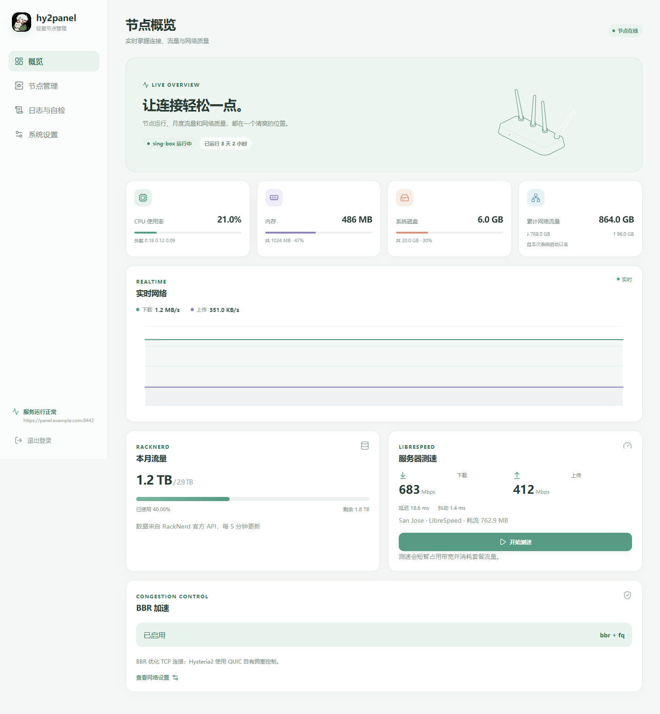
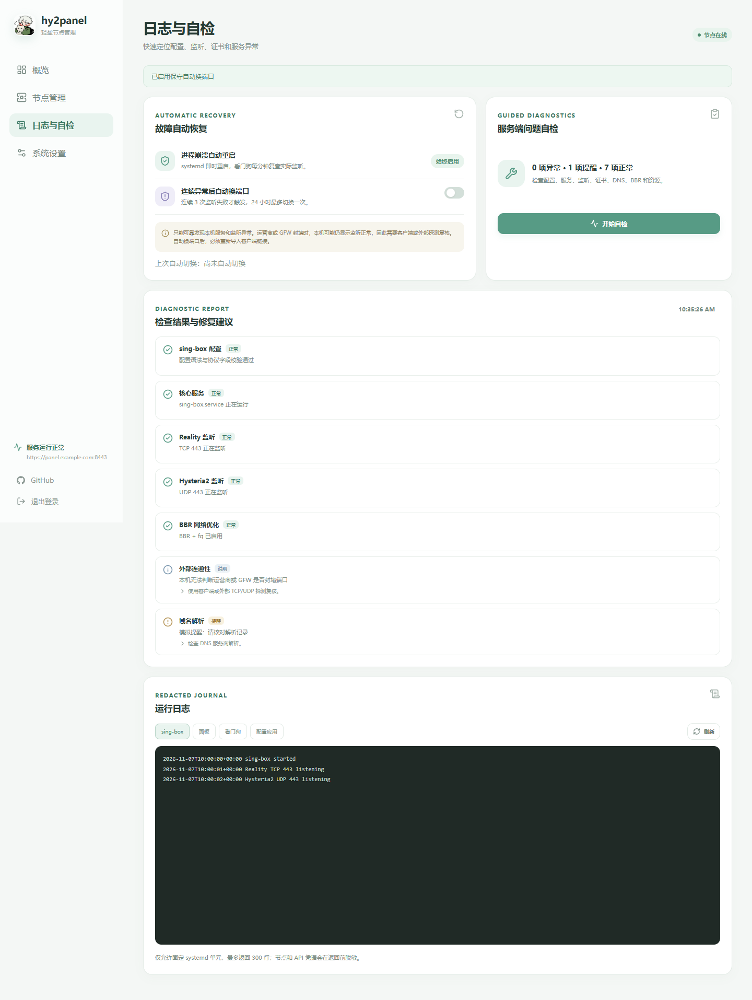

# hy2panel

一个面向单 VPS 的轻量节点面板。使用 Go + Vue，将 VLESS Reality、Hysteria2、RackNerd 套餐流量、实时系统指标、BBR 和 LibreSpeed 测速放在一个小清新控制台中。



## 功能

- VLESS Reality Vision 与 Hysteria2 配置、客户端链接和本地二维码
- 节点配置、客户端链接和二维码按协议集中展示，无需展开或切换
- 按节点公网 IP 生成「国旗 + 协议」客户端名称，如 `🇺🇸 US-Reality`
- 实时上下行速率、曲线、累计流量、CPU、内存、磁盘和运行时间
- RackNerd 官方 API 月度流量展示，成功结果缓存 5 分钟
- BBR + fq 状态展示和固定模板一键应用
- LibreSpeed 按需测速，展示延迟、抖动、上下行和测试耗流，测速期间实时显示网卡吞吐
- Hairline 指针互动图形、浅色响应式界面
- 节点配置预检、原子应用和启动失败回滚
- 固定单元日志查看、凭据脱敏和逐项服务端自检
- systemd 自动重启、每分钟监听检查及保守自动换端口
- 面板内检查 GitHub 最新版本并安全一键升级，校验 SHA-256、失败自动回滚、保留现有配置
- HTTPS、管理 IP 白名单、登录限流、HttpOnly/SameSite Strict 会话
- 面板与 sing-box 非 root 运行，仅固定系统操作通过受控 root 单元执行

## 环境要求

- Debian 12，x86_64
- 建议至少 1 核 CPU、1 GB 内存
- 面板和 Hysteria2 两个域名已解析到 VPS
- ACME 验证期间可从公网访问 TCP 80
- 放行 TCP 443、UDP 443；TCP 8443 由安装器限制为管理 IP
- 使用 root 执行安装

## 交互式一键安装

直接执行一行命令：

```bash
curl -fsSL https://raw.githubusercontent.com/LinyuFiee/hy2panel/main/scripts/bootstrap.sh | bash
```

脚本会通过 `/dev/tty` 依次询问：

1. 面板域名
2. Hysteria2 证书域名
3. Reality 公网地址
4. 允许访问面板的公网 IP 或 CIDR
5. ACME 邮箱，可留空
6. RackNerd API Key/Hash，可留空且不回显，稍后可在面板设置

确认摘要后自动下载对应 Release、校验 SHA-256、申请证书、配置 BBR 并启动服务。安装完成后，凭据保存在：

```text
/root/hy2panel-credentials
```

面板地址为 `https://面板域名:8443`。

## 无人值守安装

所有必填值均可通过环境变量提供。设置 `HY2PANEL_NONINTERACTIVE=1` 后不会读取终端：

```bash
export HY2PANEL_NONINTERACTIVE=1
export PANEL_DOMAIN="panel.example.com"
export HY2_DOMAIN="hy2.example.com"
export PUBLIC_HOST="203.0.113.10"
export ADMIN_IP="198.51.100.20"
export ACME_EMAIL="admin@example.com"
export RACKNERD_API_KEY=""
export RACKNERD_API_HASH=""
curl -fsSL https://raw.githubusercontent.com/LinyuFiee/hy2panel/main/scripts/bootstrap.sh | bash
```

默认安装最新 Release。固定版本：

```bash
export HY2PANEL_VERSION="v0.4.2"
```

## RackNerd 流量配置

在 RackNerd 对应 VPS 的控制页面启用 API，获取该 VPS 独立的 API Key 和 API Hash，然后在「系统设置 → RackNerd 官方流量」填写。

面板只调用：

```text
action=info
bw=1
status=1
rdtype=json
```

`bw` 按 `total_bytes,used_bytes,free_bytes,percent_used` 解析。不会调用 boot、reboot、shutdown 等电源操作。凭据仅保存在 `/etc/hy2panel/panel.json`，该文件权限为 600；状态接口不会返回 Key 或 Hash。

API 请求失败时，错误信息仅显示在管理面板。成功结果缓存 5 分钟，失败结果缓存 1 分钟，避免频繁请求官方接口。

## BBR 与测速

「系统设置」中的 BBR 按钮只应用项目内置的 `/etc/hy2panel/99-hy2panel.conf` 模板，不接收任意 sysctl 参数。BBR 主要优化 Reality 的 TCP 连接；Hysteria2 使用 QUIC 自有拥塞控制。

测速使用 LibreSpeed CLI，默认 3 并发、下载和上传各 8 秒、禁用 ICMP、使用 HTTPS。只有点击「开始测速」才会运行，不会后台定时测速。测速会短暂占用网络并消耗套餐流量。

LibreSpeed 返回的 `download`/`upload` 单位是 Mbps，面板直接按 Mbps 展示，不再换算为 bps。测速进行中，卡片会每秒读取 `/proc/net/dev` 计算实时网卡吞吐；该数值包含服务器上的其他连接，仅用于观察趋势，最终结果以 LibreSpeed 输出为准。

## 节点命名与地理位置

面板会解析节点地址的公网 IP，通过 `https://ipwho.is` 查询国家代码，并生成带国旗的客户端名称：

```text
🇺🇸 US-Reality
🇺🇸 US-Hysteria2
```

查询结果缓存 24 小时，失败时缓存 10 分钟并回退为 `🌐 Reality` / `🌐 Hysteria2`。私网、回环、链路本地和 RFC 保留文档地址不会发起查询。该查询会把节点公网 IP 发送给第三方服务；如不希望外部查询，可忽略国旗名称，客户端链接和连接本身不依赖此功能。

## 面板更新

「系统设置 → 面板更新」会读取 GitHub Release 的最新标签，与当前版本比较后提示是否有更新。点击「一键升级」后：

1. 面板写入 `/etc/hy2panel/upgrade.request`，由 `hy2panel-upgrade.path` 触发受控 root 单元
2. 从最新 Release 下载 `hy2panel-bundle-linux-amd64.tar.gz` 及其 `.sha256`
3. 校验失败立即停止，不修改现有文件
4. 备份当前二进制、系统脚本和 systemd 单元后再安装
5. 重新渲染并应用配置；任何一步失败都会回滚并重启旧版面板

升级不会覆盖 `/etc/hy2panel/panel.json`，域名、密钥、UUID、密码和 RackNerd 凭据保持不变。升级完成后页面需要刷新一次。GitHub API 不可达时只显示错误，不会影响节点运行。

### 从 v0.3.x 升级到 v0.4.0

v0.3.x 尚未安装升级单元，需要在服务器上手动执行一次。脚本会下载最新发布包、校验 SHA-256、备份后替换二进制与 systemd 单元，并保留现有配置：

```bash
curl -fsSL https://raw.githubusercontent.com/LinyuFiee/hy2panel/v0.4.0/scripts/hy2panel-upgrade.sh -o /tmp/hy2panel-upgrade.sh
bash /tmp/hy2panel-upgrade.sh
```

执行完成后 `hy2panel-upgrade.path` 已启用，后续版本可直接在面板内一键升级。若脚本失败，会自动恢复旧二进制和单元。

## 日志、自检与自动恢复

「日志与自检」页面提供：

- 配置语法、核心服务、TCP/UDP 实际监听、证书有效期、DNS、Reality 握手目标、BBR 和系统资源检查
- 每项异常对应的修复建议
- sing-box、面板、看门狗和配置应用日志，固定单元、固定行数并在返回前脱敏
- 进程退出时由 systemd 自动重启，看门狗每分钟复查实际监听

连续 3 次监听失败后，看门狗会先尝试重启。仍无法恢复且已显式开启「自动换端口」时，才会从 `2053、2083、2087、2096、10443` 中选择未被占用的候选端口，同时调整 Reality 和 Hysteria2，并保留配置备份。配置应用失败会恢复原配置。

自动换端口默认关闭，24 小时最多切换一次。切换成功后必须重新导入客户端链接和二维码。

**本机无法可靠判断运营商或 GFW 是否封堵端口。** 服务监听正常不代表客户端一定可达。外部封锁需要客户端或外部 TCP/UDP 探测复核，不应仅凭服务端自检频繁切换端口。



## 安全说明

- 域名不等于隐藏节点 IP；Reality 和 Hysteria2 客户端最终都会连接节点地址。
- 面板使用独立 TCP 8443，不占用 Reality 的 TCP 443。
- nftables 与后端同时检查管理 IP；不要随意将白名单改为 `0.0.0.0/0`。
- 客户端链接和二维码包含完整连接凭据，请勿公开分享。
- 初始密码只显示在 root 凭据文件中，不要提交到 issue 或聊天截图。
- 安装器检测到已有 `/etc/hy2panel/panel.json` 时会停止，避免覆盖现有密钥。
- README 和测试中的 `203.0.113.10`、`198.51.100.20`、`192.0.2.10` 均为 RFC 保留示例地址，不是用户真实 IP。
- 交互安装摘要中的公网 IP 和管理 IP 来自当前输入或 SSH 会话，仅显示在本机终端，不会写入 GitHub 脚本或文档。
- 面板服务仅附加 `systemd-journal` 组以读取日志，不以 root 身份运行。

## 本地开发

```bash
cd web
npm ci
npm run build
cd ..
go test ./...
go vet ./...
CGO_ENABLED=0 GOOS=linux GOARCH=amd64 go build -trimpath -o dist/hy2panel-linux-amd64 ./cmd/hy2panel
```

UI 视觉冒烟测试：

```bash
cd web
npx playwright install chromium
npm run test:ui
```

模拟 API 仅在 `MOCK_UI=1` 的 Vite 开发服务器中启用，不进入生产后端。

## 发布

推送 `v*` 标签后，GitHub Actions 会自动构建前端、执行 Go 测试与脚本检查、生成 Linux 安装包、计算 SHA-256 并创建 Release。

## 第三方项目

- [Hairline](https://github.com/lucasmarkes/hairline)：MIT，指针互动线条图形
- [LibreSpeed CLI](https://github.com/librespeed/speedtest-cli)：LGPL-3.0，按需服务器测速
- [Lucide](https://github.com/lucide-icons/lucide)：ISC，界面图标

详细许可见 [THIRD_PARTY_NOTICES.md](THIRD_PARTY_NOTICES.md)。