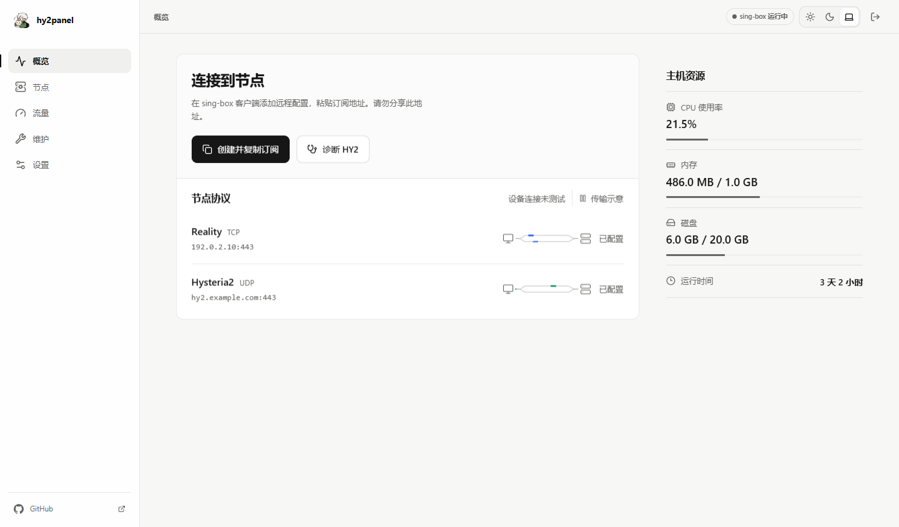

# hy2panel

面向个人、单台 VPS、单节点的轻量管理面板。Go + Vue 编写，管理 VLESS Reality 与 Hysteria2，并集中展示协议流量、系统状态、RackNerd 套餐流量、BBR 与 LibreSpeed 测速。

它不是多用户、集群或商业计费平台，也不替代主机防火墙、外部监控和备份系统。



## 版本策略

只支持 **0.6.1 及以上**。

- 安装器始终下载最新稳定 Release，不提供历史版本固定安装。
- 升级请求的 `target_version` 低于 0.6.1 会被直接拒绝并返回 `failed_no_change`。
- v0.4 → v0.5 的一次性迁移器已移除；更早的安装需先自行升级到 0.6.1 以上。

## 功能

- 五区控制台（概览 / 节点 / 流量 / 维护 / 设置），亮色、暗色、跟随系统三种主题与移动端底部导航
- VLESS Reality Vision 与 Hysteria2 配置、按需显示的客户端链接和本地二维码
- Reality / Hysteria2 实时速率、累计有效载荷、活动代理流与最多 7 天分钟趋势
- 无法安全归类的代理流量单列为「未归属」
- 主机上下行、CPU、内存、磁盘和运行时间
- RackNerd 官方 API 月度套餐流量，成功结果缓存 5 分钟
- BBR + fq 固定模板与 LibreSpeed 按需测速
- 配置预检、原子应用、服务健康检查和失败回滚
- sing-box 版本 allowlist、资产 size/SHA-256 校验、切换与上一版本回滚
- 面板精确目标版本升级、维护互斥、升级快照和失败回滚
- `hy2` 管理命令、配置备份/恢复和保守卸载
- HTTPS、强密码策略、按直接来源 IP 登录限流、HttpOnly/SameSite Strict 会话
- 面板与 sing-box 非 root 运行；固定系统操作由受控 root 单元完成

## 环境要求

- Debian 12，x86_64（发布包仅提供 `linux/amd64`）
- 建议至少 1 核 CPU、1 GB 内存
- 面板域名与 Hysteria2 域名均已解析到 VPS
- ACME 验证期间可从公网访问 TCP 80
- 放行 TCP 8443、TCP 443、UDP 443；修改节点端口后需同步云防火墙和主机防火墙
- root 权限

面板固定使用公网 TCP 8443，**不限制来源 IP**。安全边界依赖有效 HTTPS、足够强且唯一的管理员密码，以及按直接来源 IP 的登录限流；建议再用云防火墙、VPN 或反向代理访问策略收窄入口。项目不信任 `X-Forwarded-For`。

## 安装

### 交互式

```bash
curl -fsSL https://raw.githubusercontent.com/LinyuFiee/hy2panel/main/scripts/bootstrap.sh | bash
```

脚本通过 `/dev/tty` 依次询问面板域名、Hysteria2 证书域名、Reality 公网地址、ACME 邮箱（可留空）、RackNerd API Key/Hash（可同时留空，稍后在面板设置）。确认摘要后，脚本下载最新 Release、校验 bundle SHA-256、申请证书、应用 BBR 模板并启动服务。

面板地址与随机管理员密码保存在仅 root 可读的 `/root/hy2panel-credentials`。首次登录后建议立即执行 `hy2 passwd` 设置独立强密码。

非 root 用户执行需要系统权限的 `hy2` 操作时，交互终端会询问是否通过 `sudo` 获取 root；拒绝或系统未安装 sudo 时不执行该操作。

### 无人值守

```bash
export HY2PANEL_NONINTERACTIVE=1
export PANEL_DOMAIN="panel.example.com"
export HY2_DOMAIN="hy2.example.com"
export PUBLIC_HOST="203.0.113.10"
export ACME_EMAIL="admin@example.com"
export RACKNERD_API_KEY=""
export RACKNERD_API_HASH=""
curl -fsSL https://raw.githubusercontent.com/LinyuFiee/hy2panel/main/scripts/bootstrap.sh | bash
```

可选的 `SING_BOX_VERSION` 指 sing-box 核心版本，必须是 bundle 内 `packaging/sing-box-versions.json` allowlist 中的**精确版本**（无 `v` 前缀），任意版本、部分版本和未知版本都会被拒绝：

```bash
export SING_BOX_VERSION="1.14.4"
```

未指定时安装清单中唯一标为 `recommended` 的版本。allowlist 同时固定官方资产名称、字节数和 SHA-256。

## 协议流量口径

「协议流量」来自 sing-box 本机 Clash API 的全局计数与活动连接快照，经本地采样后归类：

- **Reality**：类型为 `vless/reality` 的流
- **Hysteria2**：类型为 `hysteria2/hysteria2` 的流
- **未归属**：未知类型，以及全局增量中无法可靠对应到上述活动流的部分
- **活动代理流**：采样时仍在 sing-box 连接列表中的流数量，不是在线用户数

上传/下载沿用 Clash API 方向，累计值是 sing-box 观察到的**代理有效载荷近似值**，不含 IP/TCP/UDP/QUIC/TLS 头、重传、握手、探测、面板、SSH、测速和同机其他进程流量；采样中断会标记缺口。它不是网卡字节账本，也不是运营商或 RackNerd 计费口径，**不可用于结算、配额执法或审计**。

持久化状态只保留协议分类、字节基线、分钟桶和活动流 ID，不保存对端地址、域名、进程、路由规则或完整连接元数据。采集不可用时，主机网络指标和节点转发不受影响。

## sing-box 版本

「系统设置 → sing-box 核心」只列出本次面板包内的兼容清单。切换时服务器依次执行：精确定位 GitHub Release 资产 → 校验元数据、字节数和 SHA-256 → `sing-box version` 与生产配置 `check` → 原子切换并重启 → 健康检查失败时恢复上一版本。

```bash
hy2 sing-box list
hy2 sing-box set 1.14.4
hy2 sing-box rollback
```

仅保留当前版本和上一版本。回滚只在确实存在上一版本时可用，且只恢复核心二进制，不回滚面板配置。网络中断、GitHub 限流或磁盘不足会使下载/切换失败，需结合 `hy2 logs sing-box` 与 systemd 日志排查。

## `hy2` 管理命令

直接运行 `hy2` 打开交互菜单，也可使用子命令：

```text
hy2 status
hy2 info
hy2 logs [panel|sing-box|watchdog|apply|upgrade]
hy2 restart [panel|proxy|all]
hy2 check
hy2 passwd
hy2 backup [文件]
hy2 restore <文件>
hy2 sing-box list
hy2 sing-box set <版本>
hy2 sing-box rollback
hy2 update
hy2 uninstall [--purge-data]
```

除只读查看外，多数维护操作需要 root。`hy2 update` 会要求输入精确的 `X.Y.Z` 目标版本。

## 升级

面板 UI 的「系统设置 → 面板更新」先从 GitHub 最新稳定 Release 取得精确目标版本，再提交含该版本的升级请求。服务器只下载 `v目标版本` 的固定 bundle 与 `.sha256`，并验证包内二进制报告的版本完全一致。

```bash
hy2 update    # 交互输入目标版本，例如 0.6.1
```

升级流程：预检下载和校验 → 记录受管文件/单元快照 → 安装新文件 → 配置迁移与渲染 → 重启核心和面板 → 健康检查 → 提交。配置、二进制、脚本和 systemd 单元在同一维护锁内处理，失败时尝试恢复快照。`/etc/hy2panel/panel.json` 不会被新包覆盖，域名、UUID、密钥、密码与 RackNerd 凭据会保留。

`/etc/hy2panel/upgrade.result` 的 `status` 有四种终态：`succeeded`、`failed_rolled_back`（失败已自动恢复）、`rollback_failed`（回滚也失败，需人工介入）、`failed_no_change`（预检失败，系统未改动）。

升级使用原子替换、阶段日志和开机恢复单元来降低中断风险，但**不承诺任意掉电点都能无人值守恢复**。归档内 SHA-256 用于发现传输或存储损坏，不是可信签名。断电、文件系统损坏、磁盘耗尽或回滚本身失败后，可查看：

```bash
hy2 status
hy2 logs upgrade
systemctl status hy2panel-recover.service --no-pager
cat /etc/hy2panel/upgrade.result
```

升级期间面板和节点可能短暂重启；不要并行执行恢复、核心切换或其他维护操作。

## 备份与卸载

```bash
hy2 backup                                    # 默认写入 /root/hy2panel-backups/
hy2 backup /root/hy2panel-backups/manual.tar.gz
hy2 restore /root/hy2panel-backups/manual.tar.gz
hy2 uninstall                                 # 保留配置与运行数据
hy2 uninstall --purge-data                    # 同时删除 /etc/hy2panel 与运行数据
```

备份为 0600 权限的 tar.gz，包含面板配置、Reality 私钥、Hysteria2 密码、证书副本、RackNerd 凭据和协议流量状态，**没有额外加密**，请离线加密后移出 VPS。Let's Encrypt 账户、原始续期配置、sing-box 二进制和系统软件包不在备份内。恢复前会校验归档成员、内部 SHA-256、格式和配置版本，并自动创建恢复前快照。卸载前会先创建备份，且不会移除系统软件包、swap、`fstab` 项或 Let's Encrypt 数据。

## RackNerd 流量

在对应 VPS 的 RackNerd 控制页启用 API，取得独立的 API Key 和 API Hash，再到「系统设置 → RackNerd 官方流量」填写。面板只请求 `action=info`、`bw=1`、`status=1`、`rdtype=json`，不会调用 boot、reboot、shutdown 等电源操作。

凭据仅保存在 0600 权限的 `/etc/hy2panel/panel.json`，状态接口不返回 Key/Hash。成功结果缓存 5 分钟，失败缓存 1 分钟。RackNerd 套餐数据才接近供应商计费口径，协议流量卡片不能替代它。

## BBR、测速与自动恢复

BBR 按钮只应用项目内置的 `/etc/hy2panel/99-hy2panel.conf`，不接受浏览器传入任意 sysctl。BBR 主要影响 Reality 的 TCP；Hysteria2 使用 QUIC 自有拥塞控制。

LibreSpeed 仅在点击后运行，默认 3 并发、下载和上传各 8 秒、HTTPS、禁用 ICMP。测速会占用带宽并计入供应商流量；测速时显示的实时网卡吞吐包含其他连接，最终结果以 LibreSpeed 输出为准。

systemd 会在进程退出后重启服务；看门狗每分钟检查配置和实际监听，连续 3 次失败后先重启 sing-box。只有显式开启「自动换端口」且仍未恢复，才从 `2053、2083、2087、2096、10443` 中选择空闲端口，24 小时最多一次；换端口后必须重新导入客户端链接。

**服务监听正常不代表外部一定可达。** 本机无法可靠判断运营商或 GFW 封锁，需用客户端或外部 TCP/UDP 探测复核。

## 安全与限制

- 域名不会隐藏节点 IP；Reality/Hysteria2 客户端最终连接节点地址。
- 面板公网监听 8443，没有内置 IP 白名单；HTTPS、强密码、登录限流和外层访问策略缺一不可。
- 登录限流为进程内状态：每个直接来源 IP 在 5 分钟窗口内最多 5 次失败，面板重启后清零，不是完整 WAF 或抗 DDoS 方案。
- 客户端链接、二维码和备份都含完整连接凭据，不要公开分享。
- 初始密码仅写入 root 凭据文件；不要发到 issue、日志或截图。
- 安装器发现已有 `/etc/hy2panel/panel.json` 会停止，避免覆盖密钥。
- 面板服务仅附加 `systemd-journal` 组读取日志，不以 root 运行；维护单元具有固定的 root 权限。
- 升级、备份和核心切换都需要磁盘空间；空间不足会在事务中途失败，请先执行 `df -h /` 与 `df -i /` 确认。
- GitHub、Let's Encrypt、ipwho.is、RackNerd 和 LibreSpeed 不可用时，相应功能会失败或降级。
- 公网 IP 地理名称会把节点公网 IP 发送给 `https://ipwho.is`；成功缓存 24 小时、失败缓存 10 分钟，连接本身不依赖它。
- README 和测试中的 `203.0.113.10`、`198.51.100.20`、`192.0.2.10` 是 RFC 文档示例地址。

## 本地开发与测试

需要 Node.js 24 和 `go.mod` 指定的 Go 工具链。前端构建产物嵌入 Go 二进制：

```bash
cd web
npm ci
npm run build
cd ..
go test ./...
go test -race ./...
go vet ./...
CGO_ENABLED=0 GOOS=linux GOARCH=amd64 \
  go build -trimpath -o dist/hy2panel-linux-amd64 ./cmd/hy2panel
```

UI 测试会启动仅绑定 `127.0.0.1` 的 mock Vite 服务，截图写入 Playwright 测试产物目录，不会改写受版本控制的 `docs/images`：

```bash
cd web
npx playwright install --with-deps chromium
npm run test:ui
```

Shell 与 systemd 静态检查：

```bash
mapfile -d '' files < <(find scripts -type f \( -name '*.sh' -o -name 'hy2' \) -print0)
bash -n "${files[@]}"
shellcheck --shell=bash --severity=warning "${files[@]}"
systemd-analyze verify systemd/*.path systemd/*.service systemd/*.timer
```

`MOCK_UI=1` 只用于 Vite 开发服务器，不进入生产后端。完整 CI 还验证版本一致性、sing-box 清单中的每个资产、真实 `sing-box check`、Linux amd64 构建以及构建后工作树无 tracked 改动。

## 发布

发布标签使用 `v0.6.x`。Release workflow 复用 CI，校验标签、`internal/version.Version`、`web/package.json` 和 lockfile 完全一致，以 ldflags 注入标签版本，生成：

```text
hy2panel-bundle-linux-amd64.tar.gz
hy2panel-bundle-linux-amd64.tar.gz.sha256
```

bundle 包含 Linux 二进制、全部安装/维护脚本、事务库、sing-box 清单、第三方许可声明和当前 systemd 单元。GitHub 环境支持时还会为 bundle 生成 artifact attestation。

## 第三方项目

- [sing-box](https://github.com/SagerNet/sing-box)：GPL-3.0-or-later（另有上游名称/关联声明限制）；安装器按 allowlist 下载官方二进制，不重打包进 hy2panel bundle
- [Hairline](https://github.com/lucasmarkes/hairline)：MIT，登录、链路与空状态中的互动线稿；协议路径图为 hy2panel 自有实现
- [LibreSpeed CLI](https://github.com/librespeed/speedtest-cli)：LGPL-3.0，按需服务器测速
- [Lucide](https://github.com/lucide-icons/lucide)：ISC，界面图标

详细许可见 [THIRD_PARTY_NOTICES.md](THIRD_PARTY_NOTICES.md)。
